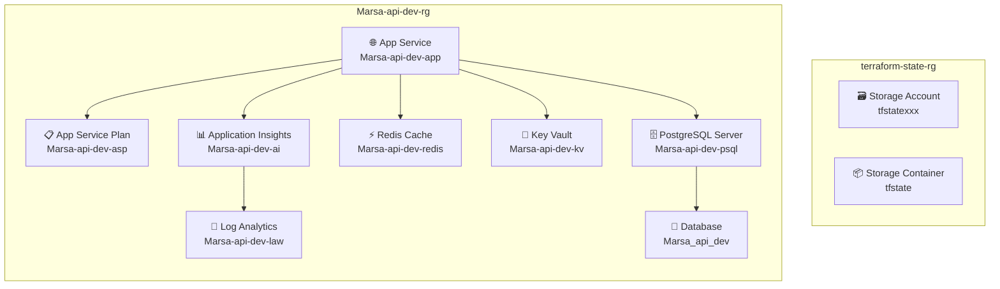

# 🚀 Marsa API - Azure Deployment Guide

Complete cloud-based deployment guide for the Marsa API using GitHub Actions, Terraform, and Azure. Optimized for Middle East deployment with UAE North (Dubai) region.

## 📋 Quick Navigation

| Resource | Purpose | Audience |
|----------|---------|----------|
| **[📋 Step-by-Step Deployment](./DEPLOYMENT_STEPS.md)** | Complete deployment checklist with commands | **First-time deployers** |
| **[🏗️ Architecture Overview](#-architecture)** | Infrastructure design and resource organization | **DevOps teams** |
| **[💰 Cost Breakdown](#-cost-breakdown)** | Detailed cost analysis for planning | **Project managers** |
| **[🔧 Troubleshooting](#-troubleshooting)** | Common deployment issues and solutions | **All users** |

---

## 🎯 **Choose Your Deployment Method**

We offer **two deployment approaches** to suit different preferences and requirements:

### **🚀 Method 1: Automated Deployment (Recommended)**
**👉 [Follow the Complete Step-by-Step Guide](./DEPLOYMENT_STEPS.md)**

- ✅ **Infrastructure as Code** with Terraform
- ✅ **Zero local tools** required (Azure Cloud Shell)
- ✅ **Automated CI/CD** with GitHub Actions
- ✅ **Reproducible** environments
- ✅ **30-minute setup** (one-time)
- ✅ **Best for teams** and production environments

### **🖥️ Method 2: Manual Azure Portal Setup**
**👉 [Manual Azure Portal Setup Guide](./MANUAL_AZURE_SETUP.md)**

- ✅ **GUI-based** resource creation
- ✅ **No Infrastructure as Code** tools needed
- ✅ **Step-by-step** portal instructions
- ✅ **Full control** over each resource
- ✅ **45-60 minute setup** (one-time)
- ✅ **Best for learning** Azure services

**💡 Both methods create identical infrastructure and have the same monthly costs**

---

## 🎯 **Ready to Deploy? Start Here!**

The step-by-step guide includes:
- ⏱️ **30-minute setup** process
- 🔐 **Azure service principal** creation
- 📋 **GitHub secrets** configuration  
- 🚀 **Automated deployment** execution
- ✅ **Verification** checklist

---

## 🏗️ Architecture

### Azure Resources
- **Azure App Service**: Node.js hosting (B1 for dev, P1v3 for prod)
- **PostgreSQL Flexible Server**: Database (B1ms for dev, GP_Standard_D2s_v3 for prod)
- **Azure Cache for Redis**: Job queue backend (Basic C0 for dev, Standard C1 for prod)
- **Azure Key Vault**: Secure secret management
- **Application Insights**: Monitoring and telemetry

### Resource Organization



**Two Resource Groups:**
- **`terraform-state-rg`**: Terraform state management (Storage Account + Container)
- **`Marsa-api-{env}-rg`**: All application resources (7 main components)

### Visual Resource Structure
```
📁 terraform-state-rg
├── 🗃️ Storage Account (tfstatexxx)
└── 📦 Storage Container (tfstate)

📁 Marsa-api-dev-rg
├── 🌐 App Service (Marsa-api-dev-app)
├── 📋 App Service Plan (Marsa-api-dev-asp)
├── 🗄️ PostgreSQL Server (Marsa-api-dev-psql)
│   └── 💾 Database (Marsa_api_dev)
├── ⚡ Redis Cache (Marsa-api-dev-redis)
├── 🔐 Key Vault (Marsa-api-dev-kv)
├── 📊 Application Insights (Marsa-api-dev-ai)
└── 📝 Log Analytics Workspace (Marsa-api-dev-law)
```

**Default Region**: UAE North (Dubai) for optimal Middle East performance

### GitHub Actions Workflows
- **`deploy-infrastructure.yml`**: Terraform deployment
- **`deploy-application.yml`**: Application deployment

## 💰 Cost Breakdown

### Development Environment (~$49/month)
- App Service B1: ~$13/month
- PostgreSQL B1ms: ~$12/month
- Azure Cache for Redis (Basic C0): ~$16/month
- Key Vault: ~$3/month
- Application Insights: ~$5/month

### Production Environment (~$241/month)
- App Service P1v3: ~$73/month
- PostgreSQL GP_Standard_D2s_v3: ~$77/month
- Azure Cache for Redis (Standard C1): ~$73/month
- Key Vault: ~$3/month
- Application Insights: ~$15/month

## 🔄 Deployment Workflows

### Infrastructure Deployment (Manual Only)
**Triggers:**
- Manual workflow dispatch only (Actions → Deploy Infrastructure → Run workflow)

**Manual Actions Available:**
- **Plan**: Preview infrastructure changes without applying
- **Apply**: Create or update infrastructure resources  
- **Destroy**: Remove all infrastructure (⚠️ **Warning**: Deletes all data)

**Process:**
- Provisions Azure resources using Terraform
- Creates App Service, Database, Key Vault, etc.
- Configures environment-specific settings

### Application Deployment (Automatic)
**Triggers:**
- Push to `main`/`develop` with application code changes
- Manual workflow dispatch

**Actions:**
- Builds the Node.js application
- Runs tests
- Deploys database migrations
- Seeds database (development only)
- Deploys to Azure App Service

**💡 Note**: Application deployment works identically whether infrastructure was created via Terraform or manually through Azure Portal.

## 🌍 Environment Configuration

### Development Environment
- **Branch**: `develop`
- **Resources**: Minimal (B1 tier)
- **Database**: Includes seeding
- **Monitoring**: Detailed logging

### Production Environment
- **Branch**: `main`
- **Resources**: Production-scale (P1v3 tier)
- **Database**: Migrations only
- **Monitoring**: Enhanced Application Insights

## 🔐 Security Features

- **Managed Identity**: App Service accesses Key Vault securely
- **SSL/TLS**: All connections encrypted
- **CORS**: Configurable allowed origins
- **Database**: SSL-only connections
- **Secrets**: Stored in Azure Key Vault

## 📊 Monitoring

### Application Insights
- **Performance**: Response times, dependencies
- **Errors**: Exception tracking and debugging
- **Usage**: API endpoint analytics
- **Custom Metrics**: Business-specific tracking

### Database Monitoring
- **Performance**: Query performance insights
- **Backup**: Automated daily backups
- **Security**: SSL connections enforced

## 🔧 Troubleshooting

### Common Issues

1. **Build Failures**
   - Check Node.js version (should be 22)
   - Verify all dependencies are installed
   - Review build logs in GitHub Actions

2. **Database Connection Issues**
   - Verify connection string in Key Vault
   - Check firewall rules in Azure Portal
   - Ensure SSL is enabled

3. **Authentication Issues**
   - Verify service principal permissions
   - Check Azure AD token expiration
   - Review Key Vault access policies

### Logs and Monitoring
- **Application Logs**: Azure Portal → App Service → Log stream
- **Application Insights**: Azure Portal → Application Insights
- **GitHub Actions**: Repository → Actions tab

## 📈 Scaling

### Environment Scaling
Update `terraform/variables.tf` to change resource sizes:
```hcl
# Development
sku_name = "B1"
db_sku_name = "B_Standard_B1ms"

# Production
sku_name = "P1v3"
db_sku_name = "GP_Standard_D2s_v3"
```

## 🧹 Cleanup

To remove all resources:
```bash
# This will be handled by GitHub Actions
# Navigate to Actions → Deploy Infrastructure → Run workflow → Destroy
```

**⚠️ Warning**: This permanently deletes all data including the database.

## 📚 Files in This Deployment Folder

- **[📋 DEPLOYMENT_STEPS.md](./DEPLOYMENT_STEPS.md)** - Complete step-by-step automated deployment guide
- **[🖥️ MANUAL_AZURE_SETUP.md](./MANUAL_AZURE_SETUP.md)** - Manual Azure Portal setup guide (no Terraform)
- **[📖 README.md](./README.md)** - This comprehensive deployment overview
- **[⚙️ setup-azure-service-principal.ps1](./setup-azure-service-principal.ps1)** - Azure Cloud Shell setup script
- **[🏗️ terraform/](./terraform/)** - Infrastructure as Code definitions

## 🆘 Getting Help

- **GitHub Issues**: Create issues in your repository
- **Azure Documentation**: [docs.microsoft.com](https://docs.microsoft.com/azure)
- **Application Logs**: Check Azure Portal for detailed error messages

---

**🚀 Ready to deploy? [Start with the step-by-step guide!](./DEPLOYMENT_STEPS.md)** 